# Make · Intake meeting (common path)

**From a recorded intake meeting to data Make can route on.**

A hiring-manager intake is recorded in Google Meet. A few minutes later, Make has 11 typed fields about the role and an 11-field screening kit. This folder covers the common path, from the trigger to the router: every step, every filter, and why each one is there.

Built live in the Make Community Live Session *“From meeting recording to structured data”* by Diane Rocher (Talent Acquisition Partner, PhantomBuster).

| File | What it is |
|---|---|
| [`intake-meeting-common-path.blueprint.json`](intake-meeting-common-path.blueprint.json) | The Make scenario. Import it (… › Import Blueprint), then pick your own connections, webhook and data structures. |
| [`CHEAT-SHEET.md`](CHEAT-SHEET.md) | The Apps Script, every prompt, formula, schema and setting, ready to paste, plus a troubleshooting table. |

---

## Start with two keys

The Apps Script connects Google Drive to Make. It needs two values, both at the top of the script.

| Key | Where it comes from |
|---|---|
| `FOLDER_ID` | **Google Drive.** Open the folder Gemini saves your notes to (“Meet Recordings”). The ID is the end of the URL, after `/folders/`. |
| `WEBHOOK_URL` | **The Make webhook.** Open your Custom webhook module and click *Copy address to clipboard*. Treat it like a password. |

## How it works

```mermaid
flowchart LR
  subgraph G["Google's side · free · every minute"]
    M[Recorded meeting<br/>Gemini notes + transcript] --> F["“Meet Recordings” folder<br/>1 doc, 2 tabs"]
    F --> W["checkNewNotes()<br/>the watcher"]
    W -->|"① name ends with<br/>“Notes by Gemini”"| S["sendToMake(file)<br/>the messenger"]
  end
  S -->|"POST { fileName, fileId }"| H
  subgraph K["Make · each module = 1 operation"]
    H[1 · Custom webhook] -->|"② fileName contains<br/>“Intake Meeting”"| D[2 · Drive: download<br/>as Markdown]
    D --> C1[3 · Claude: extract]
    C1 --> J1[4 · Parse JSON<br/>11 role fields]
    J1 --> C2[5 · Claude: screening kit<br/>JSON schema]
    C2 --> J2[6 · Parse JSON<br/>11 kit fields]
    J2 --> R[7 · Router]
  end
  R -.-> O["Your routes:<br/>Slack · Notion · new JD…"]
```



## Two filters, two jobs

Each filter sits in front of the first step that would cost something.

| | Rule | Why | Cost when it stops a file |
|---|---|---|---|
| **① In the Apps Script** | name ends with `Notes by Gemini` | The recordings folder also gets videos and other docs. Only Gemini's notes doc matters. The script also remembers what it sent, so each doc reaches Make once. | Nothing: it runs on Google. |
| **② Between modules 1 and 2** | `fileName` contains `Intake Meeting` | Gemini takes notes in every meeting: weekly syncs, 1:1s, interviews. It works because every intake is titled “Intake Meeting - &lt;role&gt;”: a naming convention, not magic. | 1 operation, about half a second. No Drive call, no Claude tokens. |

## Why a webhook and an Apps Script

Google Drive cannot call Make by itself. Something on Google's side has to ring the door.

| | Make's native “Watch Files in a folder” | Apps Script + custom webhook |
|---|---|---|
| How it works | Make asks Drive “anything new?” every 15 minutes | The script checks the folder every minute, on Google, for free |
| Cost | **96 checks a day**, about 2,900 a month, each one an operation | **1 run per real meeting** |
| Delay | Up to 15 minutes | About 1 minute |
| Setup | One module, no code | About 40 lines of script, set up once |

> **The webhook address is a password.** Anyone who has it can trigger the scenario. Keep it out of screenshots, shared blueprints and public repos. If it leaks, delete the webhook and create a new one. Make also deactivates a webhook that stays attached to no scenario for more than 5 days.

## Module by module

What each module receives, what it hands to the next one, and why it's set up that way.

| # | Module | Input | Output | Why |
|---|---|---|---|---|
| 1 | Webhooks · Custom webhook | POST from the Apps Script | `fileName`, `fileId` | Name to decide, ID to download. The content stays in Drive. |
| 2 | Google Drive · Download a File | `fileId` | `Data`: the doc as **Markdown**, Notes then Transcript | The default is Word, which Claude can't read. Markdown keeps both tabs, the headings and the attendees' mailto links. |
| 3 | Claude · Create a Prompt<br/>Haiku 4.5 · temp 0 · 800 tokens | Extraction prompt + `Data` | `Text Response`: one JSON object, as text | Extracts only. Trust the transcript over the summary, pick the person who owns the team as hiring manager, take `hm_email` from the mailto list, seniority from a fixed list. |
| 4 | JSON · Parse JSON | `Text Response`, code fences stripped | 11 fields: `role`, `role_slug`, `department`, `seniority`, `hm_name`, `skills[]`, `team`, `hm_email`, `project_context`, `key_responsibilities[]`, `summary` | Models sometimes wrap JSON in ` ```json `. The data structure makes the fields mappable before the first run. |
| 5 | Claude · Create a Prompt<br/>Haiku 4.5 · temp 0 · 1200 tokens · JSON schema | Kit prompt + `role`, `seniority`, `department`, `hm_name`, `project_context`, `team`, `summary` | `Text Response`: the kit as JSON, 11 named keys | Named keys instead of 11 lines read by position. If these inputs point to the wrong module, Claude gets empty fields and invents the role. |
| 6 | JSON · Parse JSON | Kit `Text Response` | 11 fields: `must_have_skill_1–4`, `project_context`, `screening_question_1–3`, `red_flag_1–2`, `closing_recommendation` | Any branch maps the kit by name. |
| 7 | Router | Both bundles (role + kit) | One copy per route | Extract once, before the router. Each route only maps fields. |

## Build it yourself

Four stages, in this order: Google first, then Make. Each one needs something from the one before. All the text to paste is in [`CHEAT-SHEET.md`](CHEAT-SHEET.md).

### A · Google Meet and Drive
1. **Name the calendar event.** Title every intake “Intake Meeting - &lt;role&gt;”. Gemini copies the event title into the notes doc's name, and filter ② reads that name.
2. **Turn on notes and transcript in the meeting.** In Google Meet, turn on “Take notes with Gemini” and turn on transcription. With both on, the notes doc gets a second tab with the full transcript. This needs a Google Workspace plan that includes Gemini.
3. **Find the doc after the meeting.** Gemini saves it in the organizer's Google Drive, in a folder called “Meet Recordings”, named like `Intake Meeting - Data Engineer - … - Notes by Gemini`.
4. **Copy the folder ID**: the end of the folder's URL, after `/folders/`. That's your `FOLDER_ID`.
5. **Optional, for testing:** use a separate test folder and its ID instead. Drop a copy of a notes doc into it to trigger a run. If Drive names the copy “Copy of …”, remove that prefix, or the script ignores it.

### B · Google Apps Script (before Make)
1. On script.google.com, create a new project and paste this script. Fill in `FOLDER_ID` now. Leave `WEBHOOK_URL` as it is: you get it in step C, then come back and paste it.

```javascript
// Watches a Google Drive folder and calls a Make webhook for every new
// "Notes by Gemini" doc. Paste into a new project at script.google.com.

// 1. Make: open your Custom webhook module → "Copy address to clipboard".
//    Treat it like a password: anyone who has it can trigger your scenario.
const WEBHOOK_URL = 'PASTE_YOUR_WEBHOOK_URL_HERE';

// 2. Google Drive: open the folder Gemini saves notes to (Meet Recordings),
//    and copy the end of its URL, after /folders/
const FOLDER_ID = 'PASTE_YOUR_FOLDER_ID_HERE';

// Sends only two things: the file name (to filter on) and the file ID (to download it).
function sendToMake(file) {
  UrlFetchApp.fetch(WEBHOOK_URL, {
    method: 'post',
    contentType: 'application/json',
    payload: JSON.stringify({ fileName: file.getName(), fileId: file.getId() }),
  });
  console.log('Sent to Make: ' + file.getName());
}

// Sends each Notes doc once. It remembers what it already sent in `seen`.
function checkNewNotes() {
  const props = PropertiesService.getScriptProperties();
  const seen = JSON.parse(props.getProperty('seen') || '[]');
  const files = DriveApp.getFolderById(FOLDER_ID).getFiles();
  const inFolder = [];

  while (files.hasNext()) {
    const file = files.next();
    if (!file.getName().endsWith('Notes by Gemini')) continue;
    inFolder.push(file.getId());
    if (!seen.includes(file.getId())) sendToMake(file);
  }
  props.setProperty('seen', JSON.stringify(inFolder));
}

// 3. Run this once by hand: Google then runs checkNewNotes every minute, for free.
function installTrigger() {
  ScriptApp.getProjectTriggers().forEach(t => ScriptApp.deleteTrigger(t));
  ScriptApp.newTrigger('checkNewNotes').timeBased().everyMinutes(1).create();
}

// To stop it.
function removeTrigger() {
  ScriptApp.getProjectTriggers().forEach(t => ScriptApp.deleteTrigger(t));
}
```

2. The four functions:

| Function | What it does | When to run it |
|---|---|---|
| `installTrigger` | Tells Google to run `checkNewNotes` every minute | **Once**, by hand, after pasting the script |
| `checkNewNotes` | The watcher: looks at the folder and sends each new “Notes by Gemini” doc to Make, once | Runs on its own every minute. Run it by hand to send a doc right away |
| `sendToMake` | The messenger: posts `fileName` + `fileId` to the webhook | **Never by hand**: it needs a file, so on its own it fails with “cannot read getName of undefined” |
| `removeTrigger` | Stops the every-minute check | When you want to turn it off |

3. Once `WEBHOOK_URL` is filled in (step C), save, then in the function dropdown next to **Run**, choose **`installTrigger`** › Run. The dropdown shows `sendToMake` first: always check what it says before clicking Run.
4. Approve the authorization. “This app isn't verified” is normal for your own script: Advanced, then go to the project.
5. Check **Triggers** (clock icon): `checkNewNotes`, time-based, every minute. Check **Executions**: when a new doc lands, the log says “Sent to Make”.

### C · Make: the webhook
1. Create a scenario. Add **Webhooks › Custom webhook**, click **Add**, give it a name, save.
2. Click **Copy address to clipboard** and paste it into `WEBHOOK_URL` in the script (step B). Save the script.
3. **Save the scenario.** Until it's saved, Make answers `410 · There is no scenario listening for this webhook`.
4. Click the webhook module › **Redetermine data structure**. Drop a notes doc in the folder, or run `checkNewNotes`: Make shows “Successfully determined”. Save the scenario.

### D · Make: modules 2 to 7
1. Connect Google Drive with the account that owns the notes, and Anthropic with your own API key.
2. Add the modules in the order of the table above, and set filter ② on the link between modules 1 and 2.
3. After pasting a prompt or formula, **re-map every bubble by clicking**: module numbers change from one scenario to the next.
4. Leave the scenario off while you build. Use **Run once** and drop a doc in the folder: the bubbles show what each module received and returned. Open every one of them at least once. A green run can still be wrong.
5. When every module's output looks right, switch the scenario on.
